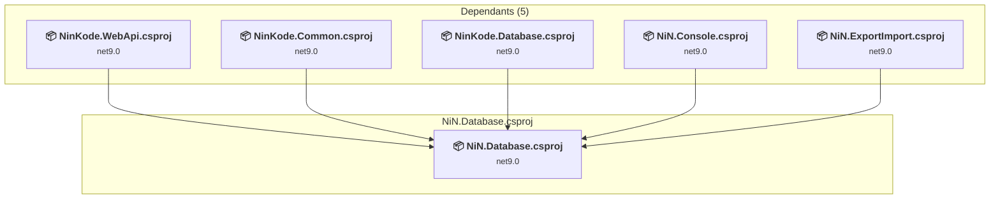

# NiN.Database\NiN.Database.csproj

[← Back to the assessment index](../../assessment.md)

## Project Info

- **Current Target Framework:** net9.0
- **Proposed Target Framework:** net11.0
- **SDK-style**: True
- **Project Kind:** ClassLibrary
- **Dependencies**: 0
- **Dependants**: 5
- **Number of Files**: 26
- **Number of Files with Incidents**: 1
- **Lines of Code**: 796
- **Estimated LOC to modify**: 0+ (at least 0,0% of the project)

## Related Projects

**Depended on by (5)** — projects that reference this one:

- [C:\Repo\Artsdatabanken\nin-kode-api\NiN.Console\NiN.Console.csproj](../projects/NiN.Console.md)
- [C:\Repo\Artsdatabanken\nin-kode-api\NiN.ExportImport\NiN.ExportImport.csproj](../projects/NiN.ExportImport.md)
- [C:\Repo\Artsdatabanken\nin-kode-api\NinKode.Common\NinKode.Common.csproj](../projects/NinKode.Common.md)
- [C:\Repo\Artsdatabanken\nin-kode-api\NinKode.Database\NinKode.Database.csproj](../projects/NinKode.Database.md)
- [C:\Repo\Artsdatabanken\nin-kode-api\NinKode.WebApi\NinKode.WebApi.csproj](../projects/NinKode.WebApi.md)

## Dependency Graph

Legend:
📦 SDK-style project
⚙️ Classic project

## API Compatibility

| Category | Count | Impact |
| :--- | :---: | :--- |
| 🔴 Binary Incompatible | 0 | High - Require code changes |
| 🟡 Source Incompatible | 0 | Medium - Needs re-compilation and potential conflicting API error fixing |
| 🔵 Behavioral change | 0 | Low - Behavioral changes that may require testing at runtime |
| ✅ Compatible | 708 |  |
| ***Total APIs Analyzed*** | ***708*** |  |

## NuGet Package Issues

| Package | Current Version | Suggested Version | Severity | Issue |
| :--- | :---: | :---: | :---: | :--- |
| AutoMapper | 14.0.0 | 17.0.0 | 🔵 Optional | NuGet package contains security vulnerability |
| Microsoft.EntityFrameworkCore.Abstractions | 9.0.4 | 10.0.15 | 🟡 Potential | NuGet package upgrade is recommended |
| Microsoft.EntityFrameworkCore.Design | 9.0.4 | 10.0.15 | 🟡 Potential | NuGet package upgrade is recommended |
| Microsoft.EntityFrameworkCore.Proxies | 9.0.4 | 10.0.15 | 🟡 Potential | NuGet package upgrade is recommended |
| Microsoft.EntityFrameworkCore.Sqlite | 9.0.4 | 10.0.15 | 🟡 Potential | NuGet package upgrade is recommended |
| Microsoft.EntityFrameworkCore.Tools | 9.0.4 | 10.0.15 | 🟡 Potential | NuGet package upgrade is recommended |
| Newtonsoft.Json | 13.0.3 | 13.0.4 | 🟡 Potential | NuGet package upgrade is recommended |

Every project affected by these packages, and the versions the repository settles on: [aggregate NuGet packages](../nuget/aggregate-packages.md).

