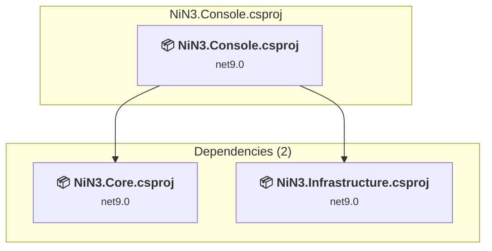

# NiN3.Console\NiN3.Console.csproj

[← Back to the assessment index](../../assessment.md)

## Project Info

- **Current Target Framework:** net9.0
- **Proposed Target Framework:** net11.0
- **SDK-style**: True
- **Project Kind:** DotNetCoreApp
- **Dependencies**: 2
- **Dependants**: 0
- **Number of Files**: 1
- **Number of Files with Incidents**: 2
- **Lines of Code**: 165
- **Estimated LOC to modify**: 6+ (at least 3,6% of the project)

## Related Projects

**Depends on (2)** — projects this one references:

- [C:\Repo\Artsdatabanken\nin-kode-api\NiN3.Core\NiN3.Core.csproj](../projects/NiN3.Core.md)
- [C:\Repo\Artsdatabanken\nin-kode-api\NiN3.Infrastructure\NiN3.Infrastructure.csproj](../projects/NiN3.Infrastructure.md)

## Dependency Graph

Legend:
📦 SDK-style project
⚙️ Classic project

## API Compatibility

| Category | Count | Impact |
| :--- | :---: | :--- |
| 🔴 Binary Incompatible | 3 | High - Require code changes |
| 🟡 Source Incompatible | 2 | Medium - Needs re-compilation and potential conflicting API error fixing |
| 🔵 Behavioral change | 1 | Low - Behavioral changes that may require testing at runtime |
| ✅ Compatible | 199 |  |
| ***Total APIs Analyzed*** | ***205*** |  |

## NuGet Package Issues

| Package | Current Version | Suggested Version | Severity | Issue |
| :--- | :---: | :---: | :---: | :--- |
| AutoMapper | 14.0.0 | 17.0.0 | 🔵 Optional | NuGet package contains security vulnerability |
| Microsoft.EntityFrameworkCore.Abstractions | 9.0.4 | 10.0.15 | 🟡 Potential | NuGet package upgrade is recommended |
| Microsoft.EntityFrameworkCore.Design | 9.0.4 | 10.0.15 | 🟡 Potential | NuGet package upgrade is recommended |
| Microsoft.EntityFrameworkCore.Tools | 9.0.4 | 10.0.15 | 🟡 Potential | NuGet package upgrade is recommended |
| Microsoft.Extensions.Configuration | 9.0.4 | 10.0.15 | 🟡 Potential | NuGet package upgrade is recommended |
| Microsoft.Extensions.Configuration.Json | 9.0.4 | 10.0.15 | 🟡 Potential | NuGet package upgrade is recommended |
| Microsoft.Extensions.Logging.Console | 9.0.4 | 10.0.15 | 🟡 Potential | NuGet package upgrade is recommended |
| Newtonsoft.Json | 13.0.3 | 13.0.4 | 🟡 Potential | NuGet package upgrade is recommended |

Every project affected by these packages, and the versions the repository settles on: [aggregate NuGet packages](../nuget/aggregate-packages.md).

